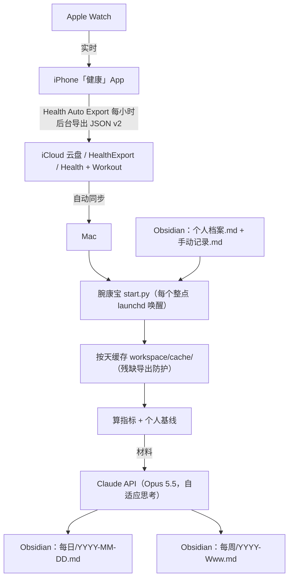

<div align="center">

<br />

# ⌚ 腕康宝 (WanKangBao) v0.2.0

### Apple Watch 数据全自动变成 Obsidian 里的每日 AI 健康报告

[](https://github.com/yijie070108/wankangbao)
[](https://github.com/yijie070108/wankangbao/releases)
[](LICENSE)
[](https://www.python.org)
[](https://obsidian.md)
[](#-你需要)
[](https://www.anthropic.com/claude)

[⚡ AI Agent 一键部署](#-ai-agent-一键部署-recommended) • [📖 快速开始](#-快速开始) • [✨ 核心特性](#-核心特性) • [🏗️ 系统架构](#️-系统架构) • [📝 报告长什么样](#-报告长什么样) • [⚙️ 配置说明](#️-配置说明)

</div>

---

> [!IMPORTANT]
> **腕康宝 (WanKangBao)** 是一套给减脂 / 增肌 / 想看懂自己身体数据的人用的个人健康系统。Apple Watch 记录 → 手机每小时自动导出到 iCloud → Mac 上的腕康宝每个整点读取，**合并数据、对照你自己的基线、结合你手填的体重 / 饮食 / 力量训练**，用 Claude Opus 5.5（思考力度开到 max）写一份「发现 → 解读 → 怎么做」的每日报告，直接写进你的 Obsidian 库；每周一再写一份带趋势图的周报。

> [!CAUTION]
> 报告由 AI 根据手表数据生成，仅供参考，**不能代替医生诊断**。

---

## ⚡ AI Agent 一键部署 (Recommended)

> **给用户的提示**：如果你在用 **Claude Code、Cursor、Codex、Windsurf** 或任意 AI 编程 Agent，复制下面这段发给它，它会帮你在 Mac 上装好并跑通示例。

```text
请按照以下步骤为我安装并试运行【腕康宝 WanKangBao】Apple Watch 健康日报系统：

1. 克隆仓库：
   - git clone https://github.com/yijie070108/wankangbao.git && cd wankangbao

2. 安装依赖：
   - 若不存在 .venv，运行 python3 -m venv .venv
   - . .venv/bin/activate && pip install -r requirements-dev.txt

3. 用虚构数据自检：
   - 运行 python -m pytest -q，确认全部通过
   - 运行 python start.py --demo --dry-run，确认 workspace/demo-vault/每日/ 下生成了 2026-01-05.md，并且 01-04 是「定稿」、01-05 是「进行中」

4. 配置我的真实环境：
   - cp config.example.json config.json
   - 问我 Obsidian 库的路径，填进 vault_dir；确认 export_dir 下有 Health/ 和 Workout/ 两个文件夹（Health Auto Export 的导出）
   - 把 vault-template/ 里我还没有的文件（个人档案.md、手动记录.md、训练计划.md、模板/每日模板.md）复制进我的库，提醒我改「个人档案.md」
   - cp .env.example .env，让我自己填 ANTHROPIC_API_KEY（不要替我编造）；如果我用 `ant auth login` 登录，就不用填

5. 跑一次真的：
   - python start.py --dry-run 看材料是否正常，再运行 python start.py
   - 运行 scripts/install_launchd.sh 装好每小时自动运行，告诉我日志在哪，并提醒我给 Python 开「完全磁盘访问权限」
```

---

## ✨ 核心特性

<div justify="center">

| 特性分类 | 核心亮点 |
| :--- | :--- |
| **⏱️ 每小时自动更新** | 今天的报告标「进行中 · 截至 HH:MM」，每小时有新数据就重写；过了午夜再来一次导出就自动「定稿」，Mac 弹通知 |
| **🩺 医生式问题清单** | 每条问题都写成「发现（数字）→ 解读（有证据才点名研究 / 指南）→ 怎么做（今天就能做）」，只写 2–4 条真正重要的 |
| **📏 和你自己比** | 代码先算好你最近 28 天每项指标的中位数、P25–P75 和标准差，AI 按「个人正常范围」判断异常，不和人群平均硬比，不把日常波动当问题 |
| **🧠 思考力度 max** | 默认 Claude Opus 5.5、自适应思考、effort=max、输出上限 128K；截断或被拒的报告不会覆盖旧报告 |
| **📚 只引用靠谱证据** | 指令里内置证据表（AASM 睡眠、ISSN 蛋白质、ACSM 进阶、WHO 活动量…），禁止编造研究；每天逐条检查固定的就医信号清单 |
| **🔗 前后对得上** | 解释今天早上的睡眠和 HRV 时，看的是昨天的饮食和训练；体重看近 7 天均值和周变化，不看单日 |
| **🛡️ 残缺导出防护** | iOS 后台导出偶尔只带一部分指标；腕康宝先合并进按天缓存（累加型取大、其他取新），好数据不会被冲掉 |
| **✍️ 手动记录页** | 自动准备今天 / 明天 / 后天的格子：体重、多吃 / 少吃（写大白话，AI 估热量）、InBody、力量训练表（「上次」列自动填，做满了提示「→ 加一格」） |
| **🏋️ 训练识别** | 一天多次训练自动合并；忘了点结束的记录（比如 58 分钟只走了 1 km）不计入，并在报告里说明 |
| **📈 周报 + 趋势图** | 每周一写上周周报：体重变化率、恢复趋势、训练完成度、按你的调整规则给结论；趋势图由代码直接生成 mermaid（Obsidian 原生渲染），数字不经 AI 转抄 |
| **🔒 只动该动的地方** | 只改 frontmatter 数字和 AI 报告那一段；你写的「备注」、填的值、自己加的字段原样保留 |

</div>

---

## 🏗️ 系统架构



每次运行做的事：

1. 整理 `手动记录.md`：补齐今天 / 明天 / 后天的格子，过去的日子挪到「历史」，刷新训练表的「上次」列
2. 读新的或 mtime 变过的导出文件，合并进按天缓存（按天、按周导出都能处理；还在 iCloud 云端的文件会先请求下载）
3. 最近 7 天里有新数据、或刚满足「定稿」条件的日子：算数字、基线、趋势 → 拼材料 → Claude 写报告 → 写回每日笔记
4. 上周日定稿后（最晚周一中午）写上周周报
5. 没有新数据就什么都不做，**不花 API 费用**；同一份数据连续失败 2 次就不再重试，等新数据

---

## 🚀 快速开始

### 你需要

- iPhone + Apple Watch
- **Health Auto Export**（App Store 付费 App），按 [docs/数据导出设置.md](docs/数据导出设置.md) 建两个每小时的 iCloud 自动化
- 一台常开的 Mac（报告由 Mac 上的脚本写；屏幕黑着没关系，但不能睡眠：系统设置 → 电池 → 选项 → 打开「显示器关闭时防止自动进入睡眠」）
- [Obsidian](https://obsidian.md)，库建议放在 iCloud，手机上也能看
- Claude API Key（[console.anthropic.com](https://console.anthropic.com/)）
- Python 3.10+

> 💡 不想写代码、已经在用 Claude 的付费订阅？也可以让 Claude 项目的定时任务直接读写你的文件，见 [docs/Claude项目模式.md](docs/Claude项目模式.md)。

### 1. 安装

```bash
git clone https://github.com/yijie070108/wankangbao.git
cd wankangbao
python3 -m venv .venv
source .venv/bin/activate
pip install -r requirements-dev.txt
```

### 2. 用虚构数据试一下

```bash
python start.py --demo --dry-run   # 不调用 Claude，只填数字、打印发给 Claude 的材料
python start.py --demo             # 有 Claude 凭据时：真的写 2 份日报 + 1 份周报（effort=max，会花钱）
```

结果在 `workspace/demo-vault/`，可以直接用 Obsidian 打开看。

### 3. 接上你自己的数据

```bash
cp config.example.json config.json   # 必填 vault_dir（你的 Obsidian 库）；按需改 export_dir、timezone、训练日
cp .env.example .env                 # 填 ANTHROPIC_API_KEY；用 `ant auth login` 登录的话可以跳过
```

把 `vault-template/` 里的 `个人档案.md`、`手动记录.md`、`训练计划.md`、`模板/每日模板.md` 复制进你的 Obsidian 库，**先把「个人档案」改成你自己的情况**（目标、食谱热量、训练日、调整规则），AI 每次写报告都会读它。

```bash
python start.py --dry-run   # 先看看材料对不对
python start.py             # 跑一次真的
```

### 4. 每小时自动运行

**方式一（推荐）**：macOS launchd，每个整点过 1 分钟跑一次：

```bash
./scripts/install_launchd.sh      # 生成 ~/Library/LaunchAgents/com.wankangbao.hourly.plist 并加载
```

> [!IMPORTANT]
> 定时任务读 iCloud 里的导出和 Obsidian 库，需要给 Python 开「完全磁盘访问权限」：运行 `realpath .venv/bin/python` 拿到路径，到 系统设置 → 隐私与安全性 → 完全磁盘访问权限 → ＋，按 ⌘⇧G 粘贴路径加进去。没开的话，日志 `workspace/launchd.log` 里会写「没有权限读取」。收不到通知就到 系统设置 → 通知 → 脚本编辑器 → 允许通知。

**方式二**：开一个终端一直跑：

```bash
python start.py --loop
```

### 常用命令

| 命令 | 作用 |
| :--- | :--- |
| `python start.py` | 跑一次（没有新数据就直接结束） |
| `python start.py --loop` | 每个整点过 1 分钟跑一次 |
| `python start.py --date 2026-01-05` | 强制重写某一天（也会重试之前连续失败的那天） |
| `python start.py --dry-run` | 不调用 Claude，打印材料 |
| `python start.py --demo` | 用 `examples/` 的虚构数据跑一遍 |

---

## 📝 报告长什么样

完整示例见 [examples/demo-vault/每日/2026-01-04.md](examples/demo-vault/每日/2026-01-04.md)（数据虚构）。节选：

```markdown
## 每日健康报告 · 2026-01-04（周日）· 定稿

**数据截至 01-05 08:12**

> [!summary] 结论
> **训练完成得很好，四个动作有进步；恢复和睡眠都正常。** 唯一扣分的是下午那杯全糖奶茶，基本吃光了今天约 400 大卡的计划缺口。

| 维度 | 状态 | 依据 |
|---|---|---|
| 睡眠 | 🟢 | 7.3 小时，深睡 66 分钟、REM 96 分钟，和基线（7.1 小时）持平 |
| 恢复 | 🟢 | HRV 52（基线 50）；静息心率 58（基线 59） |
| 能量 | 🟡 | 估算缺口约 0–100 大卡（基本为 0）；按食谱本该有约 400 |

**1. 一杯奶茶吃光了缺口**
- **发现**：手表全天消耗约 2,316 大卡；摄入 = 食谱基数 1,900 + 中杯全糖珍珠奶茶约 350–450 大卡
- **解读**：静息消耗和 Mifflin-St Jeor 公式一致，但腕表能量消耗误差普遍超过 20%（Shcherbina 等 2017），缺口真假看 2–3 周体重趋势……
- **怎么做**：想喝就点无糖或三分糖、去掉珍珠，热量能少一半以上
```

每份报告固定包含：结论 → 状态总览 → 问题清单 → 其他指标 → 今天可以做得更好 → 明天的处方 → 什么时候该看医生。格式和原则都写在 [wankangbao/prompts/daily_report.md](wankangbao/prompts/daily_report.md)，想改风格直接改这个文件。

---

## 📂 目录结构

```
wankangbao/
├── start.py                    # 一键运行入口
├── config.example.json         # 配置示例 → 复制成 config.json
├── wankangbao/
│   ├── run.py                  # 主流程
│   ├── cache_merge.py          # 导出 → 按天缓存（残缺导出防护）
│   ├── metrics.py              # 缓存 → frontmatter 数字、训练合并
│   ├── manual_log.py           # 维护「手动记录.md」
│   ├── note.py                 # 安全地改写每日笔记
│   ├── report.py               # 拼材料、调用 Claude
│   └── prompts/                # 日报 / 周报的指令（报告格式在这里改）
├── vault-template/             # 干净的 Obsidian 库模板
├── examples/                   # 虚构的 Health Auto Export 导出 + 示例库（--demo 用）
├── docs/                       # 导出设置、Claude 项目模式
├── scripts/install_launchd.sh  # 装 macOS 定时任务
└── tests/
```

---

## ⚙️ 配置说明

`config.json`（不存在时全部用默认值）：

| 字段 | 默认值 | 作用 |
| :--- | :---: | :--- |
| `export_dir` | `~/Library/Mobile Documents/iCloud~com~ifunography~HealthExport/Documents` | Health Auto Export 的导出目录，里面要有 `Health/`、`Workout/` |
| `vault_dir` | **必填** | 你的 Obsidian 库根目录（相对路径按 config.json 所在目录算） |
| `data_dir` | `workspace/` | 缓存和运行状态 |
| `timezone` | 系统时区 | 例如 `Asia/Shanghai`，决定「今天」和「定稿」的分界 |
| `model` | `claude-opus-5-5` | 写报告用的 Claude 模型 |
| `effort` | `max` | 思考力度：`low` / `medium` / `high` / `xhigh` / `max`，越高越细、越慢、越贵 |
| `effort_in_progress` | 空 | 「进行中」报告单独用的力度，比如 `high`；空 = 和 `effort` 一样。定稿和周报始终用 `effort` |
| `fallbacks` | `true` | 安全分类器误拦时，服务端自动换模型重跑（只对 Opus 5.5 / Opus 5 / Fable 5.1 / Sonnet 5.5 生效） |
| `lookback_days` | `7` | 最近几天的数据有更新时会重写报告 |
| `train_days` | `[2, 4, 6]` | 力量训练日（周一 = 0），决定手动记录里哪天出训练表 |
| `inbody_day` | `0` | 哪天出 InBody 格子 |
| `exercises` | 6 个器械动作 | `[动作, 组数, 次数上限, 加重方式]`，「上次」列每组都做到上限时提示加重 |
| `extra_metrics` | `[]` | 额外允许发给 Claude 的指标名（默认只发运动、心率、睡眠、血氧等，见 `metrics.SEND_METRICS`） |
| `notify` | `true` | 定稿或出错时 Mac 弹通知 |

环境变量（`.env`）：

| 变量 | 作用 |
| :--- | :--- |
| `ANTHROPIC_API_KEY` | Claude API Key；也可以用 `ant auth login` 登录代替 |
| `WKB_CONFIG` | 配置文件路径（默认仓库根目录的 `config.json`） |

> 💰 **费用**：默认 `effort: max`，思考不封顶，每份报告可能要几分钟、输出很多 token。只有数据真的变了才调用 Claude，但手表一天导出十几次，今天的「进行中」报告就会重写十几次，费用主要花在这里。想省钱：把 `effort_in_progress` 设成 `high` 或 `medium`（定稿仍用 max），或者把定时改成每 3 小时一次。每次调用的 token 数会写进日志。

---

## 🔒 隐私

1. **数据只在你自己的设备之间流动**：iPhone → 你的 iCloud → 你的 Mac → 你的 Obsidian 库。
2. **唯一的外发**是写报告时发给 Claude API 的材料：个人档案、训练计划（训练日）、当天白名单内的手表指标（运动、心率、HRV、睡眠、血氧、呼吸、手腕温度等）、今天和昨天的手动记录、当天笔记的「备注」、最近 7 天的逐日数字、28 天基线、体重和 InBody 历史、力量训练历史；周报另外发最近 5 周的手动记录。**不发** GPS 路线、逐秒心率，以及「健康」App 里白名单之外的类别（生理周期、血糖、用药等）。可以用 `--dry-run` 先看清楚发了什么。
3. 缓存和状态都在本地 `workspace/`，已在 `.gitignore` 里；缓存里的训练记录会去掉 GPS 路线和逐秒数据。仓库里的示例数据全部虚构。
4. 没有配置 `vault_dir` 时程序拒绝运行，不会把真实数据写进仓库目录。

---

## 🗺️ 路线图

- [ ] 周报里的力量训练趋势表
- [ ] 支持 Health Auto Export 的 REST API 推送（不经过 iCloud）
- [ ] 英文报告

---

## 📄 开源许可证

本项目基于 [MIT License](LICENSE) 开源发布。欢迎提交 Issue 与 Pull Request！

---

<div align="center">

**🌟 如果腕康宝帮你看懂了自己的身体数据，欢迎点个 Star！**

[https://github.com/yijie070108/wankangbao](https://github.com/yijie070108/wankangbao)

</div>
